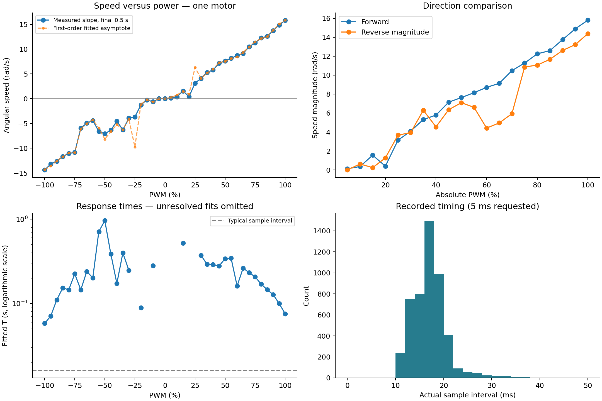
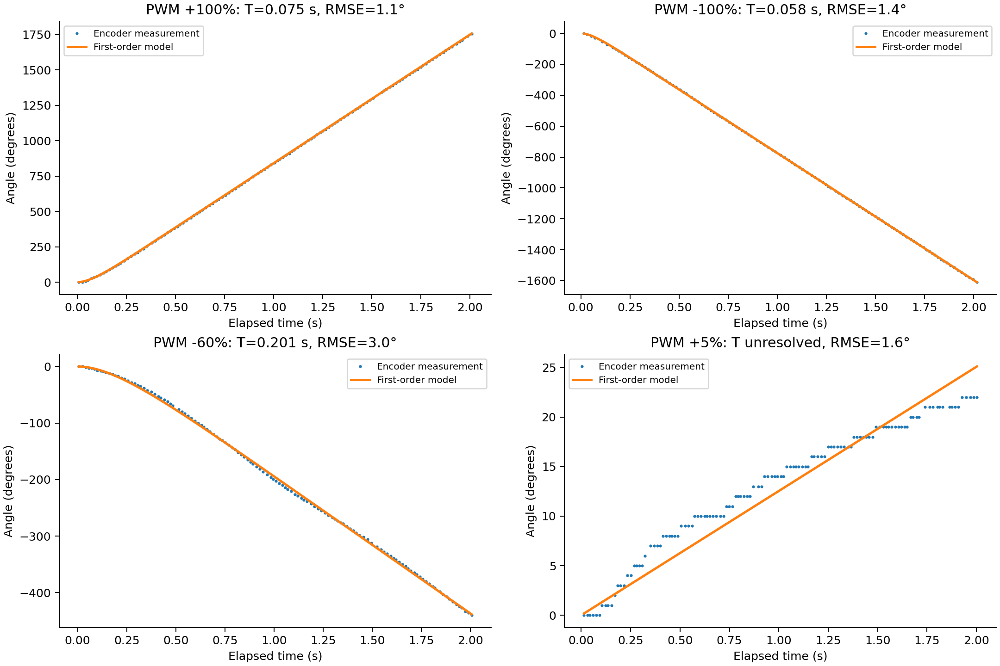

# Motor identification analysis

Source: `../Husanboy_motor_data.txt` (unaltered). Columns are PWM percent, encoder angle in degrees, and elapsed milliseconds. The data has no wheel identifier or battery voltage. The preceding collection program uses M4/E4; this report treats the log as one motor, not two wheels.

## Data quality

- 4,996 valid numeric samples; all 41 levels from −100% to +100% in increments of 5%, including zero.
- Each level has 114–128 samples, ending at 2.000–2.031 seconds. Time increases within every run. Initial samples arrive 6–17 ms after the recorded step origin; the transient before then is unobserved.
- Median actual sample interval: 16 ms (about 62.5 Hz); observed range: 11–46 ms. The requested 5 ms wait is only one part of the loop; API and execution overhead also contribute. Timing alone does not identify the execution environment.
- Exactly zero encoder movement at −5% and 0%. At +5%, total movement is 22°; at −10%, total movement is −63°. In this sweep, the observed no-motion threshold lies between 0% and +5% forward, and between −5% and −10% reverse. A repeatable static-friction threshold needs repeated starts near zero.
- Encoder angle signs agree with PWM signs whenever motion occurs.

## Model and estimation

Fit the measured angle directly, without differentiating quantized encoder readings:

`theta(t) = omega_ss * (t - T_m + T_m * exp(-t / T_m))`

Times are seconds and angles are radians. The encoder reset supplies theta(0)=0. For each candidate positive T_m, solve the least-squares omega_ss analytically, then refine T_m to minimize angle residuals. Search range: 0.0001–5 s. No delay, constant angle offset, or initial speed is fitted; their effects can therefore bias the inferred T_m. Fits at a search boundary are marked unresolved, not accepted as motor constants. R² can be high despite structured residuals and does not establish that the physical model is correct.

Also fit a straight line to theta over the final 0.5 s. Its slope is a measured late-run speed, not a guaranteed steady-state speed. It is reported separately from the model's asymptotic omega_ss.

## Main results

| Setting | Fitted omega_ss | Equivalent encoder RPM | Fitted T_m | Angle RMSE |
|---|---:|---:|---:|---:|
| +100% | 15.851 rad/s | 151.4 | 0.0752 s | 1.13° |
| −100% | -14.345 rad/s | -137.0 | 0.0579 s | 1.40° |

The fitted forward speed magnitude is 10.5% higher than reverse at full PWM. The model matches both full-power records closely. This is a difference between directions of one logged motor; it does not measure left/right wheel mismatch. Because the sweep was sequential and battery voltage was not recorded, the difference cannot be attributed solely to intrinsic direction asymmetry.

## Irregular runs and interpretation

Reverse speed is strongly non-monotonic in the middle of the sweep. For example, the final 0.5 s gives magnitude 7.09 rad/s at −50%, 4.42 rad/s at −60%, and 10.86 rad/s at −75%. The final angle magnitudes at −50% and −60% are 548° and 440°, respectively, reinforcing that this is present in the raw measurements. Forward low-power behavior is also irregular: +15% ends at 129°, whereas +20% ends at 92°. These observations require remeasurement; the log alone cannot distinguish friction/load changes, control behavior, battery effects, or another experimental cause.

At ±25%, the first-order fit reaches the 5 s upper limit: the model is extrapolating an asymptotic speed that the 2 s record does not establish. At −15%, +5%, +10%, and +20%, the fit reaches the lower limit, so T_m is unresolved. At −55% the residuals and changing speed show model mismatch. Do not average these estimates into one T_m. The CSV retains numerical optimizer results and reliability flags for transparency, but flagged boundary values are not identified physical constants.

## Full table

A dash means the parameter is unidentifiable from that run. Other flagged estimates are provisional. See `motor_parameters.csv` for all timing diagnostics and fit statistics.

| PWM (%) | Samples | T_m (s) | Model omega_ss (rad/s) | Final-0.5-s slope (rad/s) | RMSE (°) | Notes |
|---:|---:|---:|---:|---:|---:|---|
| -100 | 115 | 0.0579 | -14.345 | -14.384 | 1.40 | fit passes screening |
| -95 | 121 | 0.0707 | -13.613 | -13.221 | 2.69 | fit passes screening |
| -90 | 124 | 0.1099 | -12.559 | -12.611 | 1.12 | fit passes screening |
| -85 | 121 | 0.1528 | -11.709 | -11.669 | 1.11 | fit passes screening |
| -80 | 123 | 0.1452 | -10.958 | -11.064 | 3.08 | fit passes screening |
| -75 | 118 | 0.2244 | -10.914 | -10.860 | 1.14 | fit passes screening |
| -70 | 120 | 0.1449 | -6.100 | -5.932 | 3.86 | fit passes screening |
| -65 | 122 | 0.2395 | -5.055 | -4.958 | 1.36 | fit passes screening |
| -60 | 123 | 0.2011 | -4.241 | -4.418 | 3.03 | fit passes screening |
| -55 | 118 | 0.7137 | -5.943 | -6.609 | 14.27 | slow fit; steady state uncertain; model mismatch; speed changes after 0.5 s |
| -50 | 120 | 0.9617 | -8.169 | -7.094 | 3.07 | slow fit; steady state uncertain; speed changes after 0.5 s |
| -45 | 120 | 0.3866 | -6.628 | -6.345 | 2.14 | fit passes screening |
| -40 | 120 | 0.1726 | -5.241 | -4.544 | 5.32 | fit passes screening |
| -35 | 127 | 0.3981 | -6.273 | -6.297 | 1.66 | fit passes screening |
| -30 | 117 | 0.2472 | -4.090 | -3.933 | 1.50 | fit passes screening |
| -25 | 118 | — | — | -3.671 | 11.45 | T at search bound; unidentifiable; slow fit; steady state uncertain; model mismatch; speed changes after 0.5 s |
| -20 | 125 | 0.0888 | -1.160 | -1.263 | 2.31 | speed changes after 0.5 s |
| -15 | 123 | — | — | -0.241 | 0.99 | T at search bound; unidentifiable; T below/near sample interval; model mismatch; speed changes after 0.5 s |
| -10 | 128 | 0.2806 | -0.637 | -0.623 | 0.53 | fit passes screening |
| -5 | 128 | — | — | 0.000 | 0.00 | no motion; T unidentifiable |
| 0 | 128 | — | — | 0.000 | 0.00 | no motion; T unidentifiable |
| 5 | 122 | — | — | 0.125 | 1.60 | T at search bound; unidentifiable; T below/near sample interval; model mismatch; speed changes after 0.5 s |
| 10 | 123 | — | — | 0.356 | 5.54 | T at search bound; unidentifiable; T below/near sample interval; model mismatch; speed changes after 0.5 s |
| 15 | 121 | 0.5205 | 1.506 | 1.552 | 1.17 | slow fit; steady state uncertain |
| 20 | 122 | — | — | 0.393 | 4.91 | T at search bound; unidentifiable; T below/near sample interval; model mismatch; speed changes after 0.5 s |
| 25 | 122 | — | — | 3.135 | 8.52 | T at search bound; unidentifiable; slow fit; steady state uncertain; model mismatch; speed changes after 0.5 s |
| 30 | 120 | 0.3730 | 4.100 | 4.088 | 3.14 | speed changes after 0.5 s |
| 35 | 121 | 0.2910 | 5.187 | 5.317 | 3.37 | fit passes screening |
| 40 | 128 | 0.2898 | 5.949 | 5.784 | 3.52 | fit passes screening |
| 45 | 120 | 0.2776 | 7.279 | 7.143 | 2.05 | fit passes screening |
| 50 | 124 | 0.3409 | 7.538 | 7.635 | 1.69 | fit passes screening |
| 55 | 121 | 0.3447 | 8.116 | 8.147 | 1.44 | fit passes screening |
| 60 | 114 | 0.1611 | 8.455 | 8.711 | 5.99 | fit passes screening |
| 65 | 120 | 0.2626 | 9.358 | 9.141 | 2.38 | fit passes screening |
| 70 | 126 | 0.2322 | 10.440 | 10.482 | 1.73 | fit passes screening |
| 75 | 120 | 0.2066 | 11.491 | 11.278 | 1.83 | fit passes screening |
| 80 | 120 | 0.1695 | 12.151 | 12.250 | 1.10 | fit passes screening |
| 85 | 122 | 0.1457 | 12.534 | 12.593 | 1.50 | fit passes screening |
| 90 | 125 | 0.1272 | 13.846 | 13.752 | 2.05 | fit passes screening |
| 95 | 124 | 0.0994 | 15.072 | 14.885 | 1.50 | fit passes screening |
| 100 | 122 | 0.0752 | 15.851 | 15.807 | 1.13 | fit passes screening |

## What is still needed for Lab 5

1. Record battery voltage, ideally for each run, and document whether the wheel was free-spinning or loaded. Compute actual voltage as `U = PWM/100 * battery_voltage`. k_e cannot be calculated in V·s/rad without voltage measurements. A PWM-speed graph is not a substitute for the required voltage-speed graph.
2. Repeat this experiment for the other drive motor, using distinct files or wheel IDs. This log cannot establish a difference between the two wheels.
3. Repeat the non-monotonic reverse runs (especially −75% to −35%) and low-power runs in both directions. Repeat several starts around the dead zone. If speed keeps changing at 2 s, record longer.
4. Use measured and model angle overlays to check the repeated runs. The curves above are analytic solutions of the fitted ODE, equivalent to integrating that model with zero initial angle and speed; they are an in-sample check, not independent model validation.

## Short discussion for the lab report

The first-order model closely matches the full-power angle records, with fitted response times of about 0.075 s forward and 0.058 s reverse. Near zero power, quantization and friction make the response time difficult to identify. Several intermediate reverse-power runs are non-monotonic and should be repeated before selecting a model. The fitted forward full-power speed is about 10.5% higher than reverse, although battery voltage and load were not recorded. Only one motor is represented, so left/right wheel differences cannot yet be assessed. If the two drive wheels have different actual speeds under the same command, odometry based on an identical motor model can accumulate heading and position errors.

## Reproduce

Run `python3 analyze_motor.py` from this directory with NumPy and Matplotlib installed. Raw measurements are read but never changed. The analysis generates the parameter CSV, summary JSON, and two figures.
